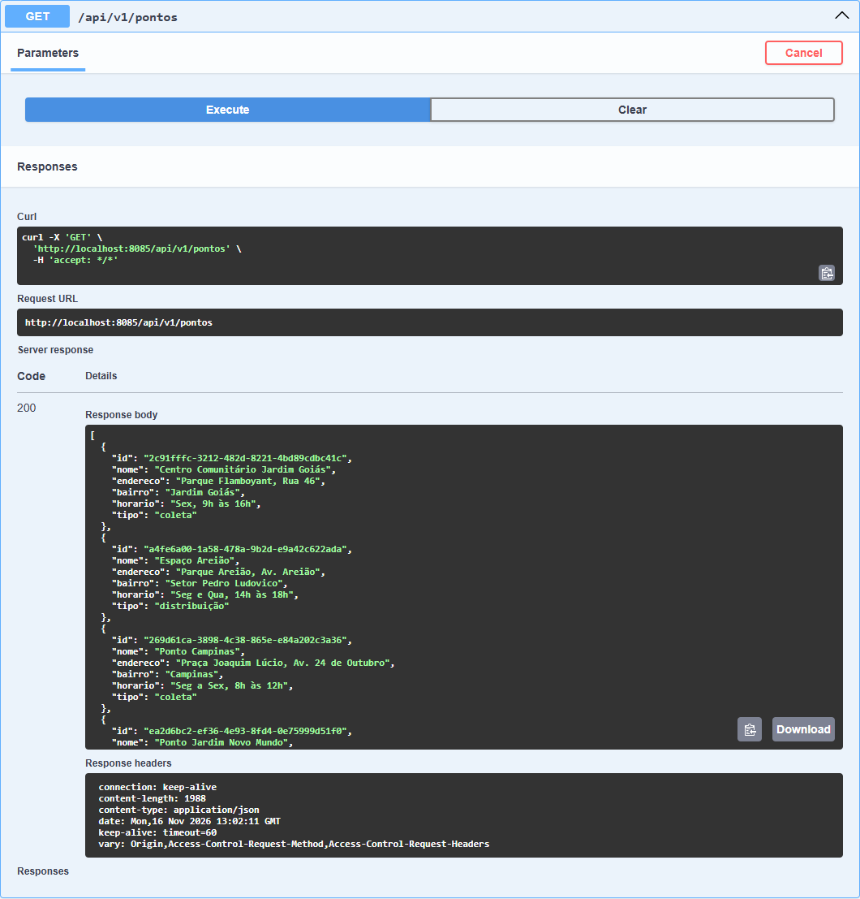
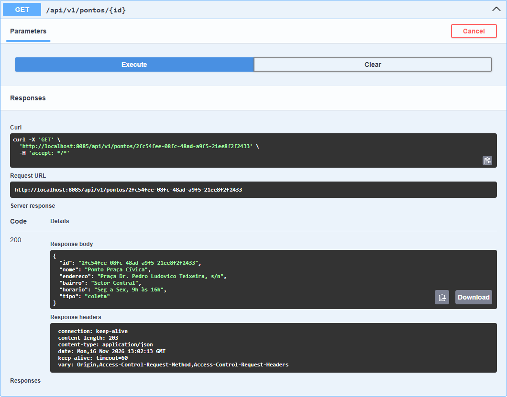
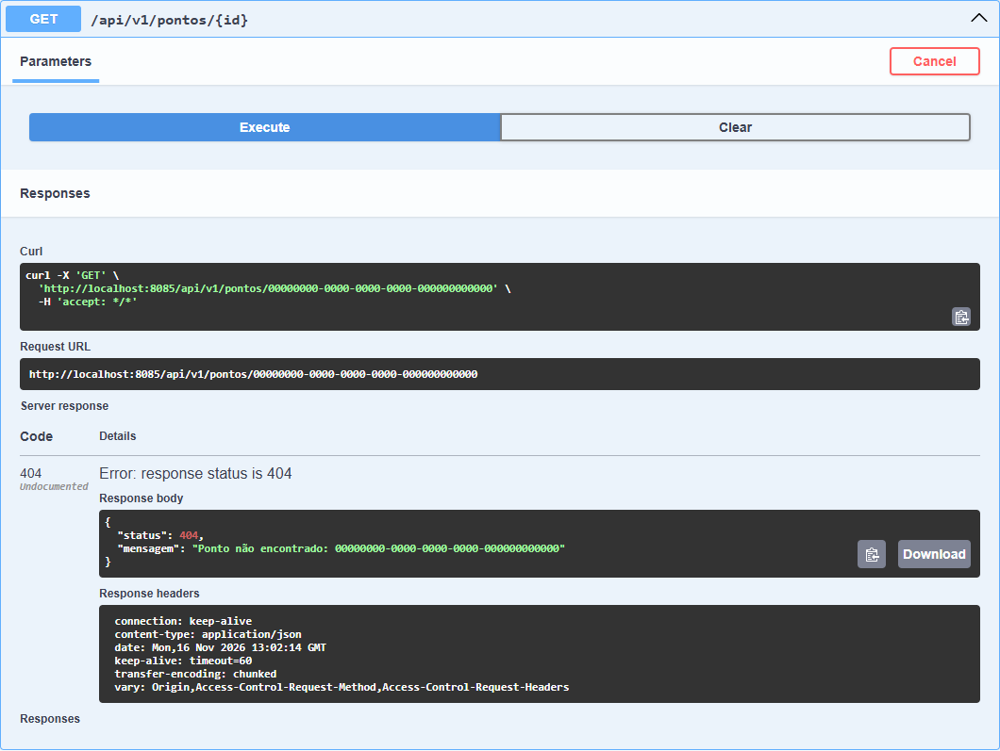
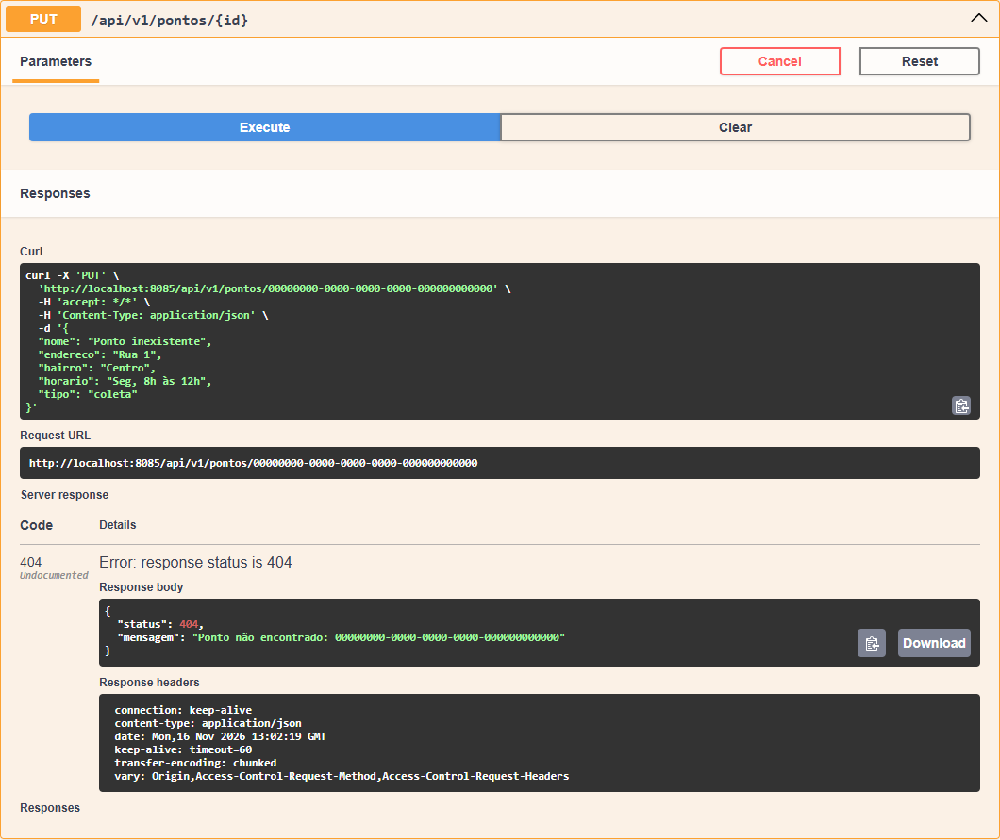

# API Instituto Mão Amiga

API Spring Boot com os pontos de coleta e distribuição do Instituto Mão Amiga. O app na raiz do repositório consome esta API.

- Java 21 (o projeto também compila com Java 17), Spring Boot 4, Spring Web, Spring Data JPA, H2, Lombok, Bean Validation e Swagger (springdoc-openapi).
- Pacotes: `entity`, `repository`, `service`, `controller`, `dto`, `config` e `exception` (tratamento de 400/404).

## Como executar

```bash
./mvnw spring-boot:run
```

No Windows: `mvnw.cmd spring-boot:run`. A API sobe em `http://localhost:8085`.

- Swagger UI: http://localhost:8085/swagger-ui.html
- Console do H2: http://localhost:8085/h2-console (JDBC URL `jdbc:h2:file:./data/institutodb`, usuário `sa`, sem senha)

O banco H2 é gravado em arquivo na pasta `api/data/` (fora do Git). Os dados cadastrados continuam lá depois de reiniciar a API. Para voltar à carga inicial, pare a API e apague a pasta `data/`.

Testes automatizados (CRUD, 400, 404, CORS e carga inicial):

```bash
./mvnw test
```

## Pontos de coleta

Campos do ponto: `id` (UUID), `nome`, `endereco`, `bairro`, `horario` (texto, ex.: `"Seg a Sex, 8h às 17h"`) e `tipo` (`"coleta"` ou `"distribuição"`).

| Método | URL | Resposta |
| --- | --- | --- |
| GET | `http://localhost:8085/api/v1/pontos` | 200 com a lista de pontos ordenada por nome |
| GET | `http://localhost:8085/api/v1/pontos/{id}` | 200 com o ponto, 404 se o id não existe |
| POST | `http://localhost:8085/api/v1/pontos` | 201 com o ponto criado, 400 se faltar campo |
| PUT | `http://localhost:8085/api/v1/pontos/{id}` | 200 com o ponto alterado, 400 se faltar campo, 404 se o id não existe |
| DELETE | `http://localhost:8085/api/v1/pontos/{id}` | 204 sem corpo, 404 se o id não existe |

Exemplo de corpo para POST e PUT:

```json
{
  "nome": "Ponto Praça do Trabalhador",
  "endereco": "Praça do Trabalhador, s/n",
  "bairro": "Setor Norte Ferroviário",
  "horario": "Dom, 7h às 12h",
  "tipo": "coleta"
}
```

Regras:

- `PontoRequestDTO` usa Bean Validation (`@NotBlank` em todos os campos e `@Pattern` no tipo) e o controller recebe com `@Valid`. Campo vazio ou só com espaços responde **400** com a mensagem do campo e nada é gravado.
- O controller sempre devolve o record `PontoResponseDTO`, nunca a entidade `Ponto`.
- `@CrossOrigin(origins = "*")` no controller libera o acesso do app (navegador e celular).
- Erros têm o formato `{ "status": 404, "mensagem": "Ponto não encontrado: ..." }`.
- `CargaInicialPontos` cadastra os pontos em Goiânia só quando a tabela está vazia, então reiniciar a API não duplica nada.

### Prints do Swagger

| Chamada | Print |
| --- | --- |
| GET lista (200) |  |
| GET por id (200) |  |
| GET id inexistente (404) |  |
| POST (201) |  |
| POST com nome e bairro vazios (400) |  |
| PUT id inexistente (404) |  |
| PUT (200) |  |
| PUT com campos vazios (400) |  |
| DELETE (204) |  |
| DELETE id inexistente (404) |  |
